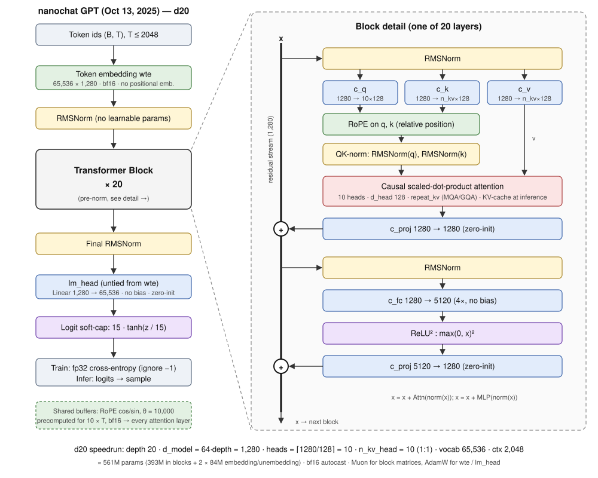

# Part 1 — Architecture Review of nanochat (Oct 13, 2025)

This reviews the original nanochat release (`3a5e0bc initial commit`, branch `a3_october_version`). The model lives in `nanochat/gpt.py`. Its size and training hyperparameters are set in `scripts/base_train.py`, and the end-to-end pipeline is `speedrun.sh`.



## 1. High-level summary

nanochat is a **decoder-only, pre-norm Transformer**. It follows GPT-2 in spirit but swaps in several "modern" components, many taken from modded-nanogpt and Llama-style models. One integer, `--depth`, sets the whole model:

| Quantity | Formula (`base_train.py`) | d20 (speedrun) |
|---|---|---|
| Layers `n_layer` | `depth` | 20 |
| Width `n_embd` | `depth × 64` (aspect ratio 64) | 1,280 |
| Query heads `n_head` | `ceil(n_embd / 128)` (head dim 128) | 10 |
| KV heads `n_kv_head` | `= n_head` (MQA supported but off) | 10 |
| MLP hidden | `4 × n_embd` | 5,120 |
| Vocab | BPE trained by `tok_train.py` (2¹⁶) | 65,536 |
| Context | `max_seq_len` | 2,048 |

**Parameter count (d20):**
- Per block: 4d² for attention + 8d² for the MLP = 12d² = 19.66M. Over 20 blocks that is **393.2M**.
- `wte`: 65,536 × 1,280 = **83.9M**. `lm_head` (untied) is another **83.9M**.
- Total ≈ **561M**. There are no biases, and the norms have no gains.

## 2. Forward pass

```
idx (B,T) ──► wte ──► RMSNorm ──► [Block] × L ──► RMSNorm ──► lm_head ──► 15·tanh(z/15) ──► CE loss / logits

Block(x):  x = x + c_proj( SDPA_causal( QKNorm(RoPE(c_q(n))), QKNorm(RoPE(c_k(n))), c_v(n) ) ),  n = RMSNorm(x)
           x = x + c_proj( ReLU(c_fc(RMSNorm(x)))² )
```

## 3. Component-by-component review

| Component | nanochat choice | GPT-2 baseline | Rationale / effect |
|---|---|---|---|
| Positional info | **Rotary embeddings (RoPE)** on q and k, θ = 10,000. cos/sin are precomputed for 10× the context and kept as non-persistent bf16 buffers | Learned absolute position embedding | Encodes relative position and adds no parameters. Offsetting by `kv_cache.get_pos()` makes KV-cached decoding straightforward. The code leaves a TODO to raise θ (e.g. to 100K). |
| Normalization | **RMSNorm with no learnable parameters** (`F.rms_norm`), pre-norm. Also applied right after the embedding and before `lm_head` | LayerNorm with gain and bias | Cheaper and simpler. Normalizing the embedding output stabilizes training given the large embedding LR (0.2). |
| QK-norm | RMSNorm on q and k after RoPE | none | Bounds the attention logits, which stops them from blowing up under the aggressive Muon LRs. Attention uses the default 1/√d scale. |
| Attention | `F.scaled_dot_product_attention` (Flash), causal. Has a **MQA/GQA** path (`repeat_kv`) and three masking cases for KV-cache inference: full-causal, single query, and chunked prefix | MHA | The MQA hooks exist, but the speedrun uses `n_kv_head = n_head`, so it is plain MHA. Head dim is fixed at 128. |
| MLP | 4× expansion with **ReLU²** activation | 4× with GELU | ReLU² (Primer / modded-nanogpt) costs the same as GELU and empirically does better, without the extra matrix a SwiGLU gate needs. |
| Biases | **None** in any Linear | Biases everywhere | Fewer parameters and simpler code. Modern LLMs show biases are unnecessary. |
| Embedding / unembedding | **Untied**. `wte` stored in bf16 | Tied | Untying lets each matrix get its own LR and optimizer. It costs about 84M extra parameters, roughly 15% of d20. |
| Output | **Logit soft-cap** 15·tanh(z/15). Logits upcast to fp32 for the CE loss | none | Comes from Gemma 2. Stops overconfident logits and keeps the loss numerically stable. |
| Init | Linear layers: N(0, 1/√fan_in · min(1, √(fan_out/fan_in))) (arXiv 2310.17813). Embedding: N(0, 1). **Zero-init** for `lm_head` and every `c_proj` | N(0, 0.02) with 1/√(2L) on the residual projections | Zeroed output projections mean each block starts as the identity, so the residual stream begins "clean". The model is built on the `meta` device and then materialized with `to_empty` and `init_weights`. |

## 4. Training-system choices tied to the architecture

- **Two optimizers, split by parameter type** (`GPT.setup_optimizers`):
  - **Muon** handles every 2-D matrix inside the blocks: LR 0.02, momentum ramped 0.85 → 0.95 over 300 steps, and 5 Newton–Schulz orthogonalization steps in bf16.
  - **AdamW** handles `wte` (LR 0.2) and `lm_head` (LR 0.004), with β = (0.8, 0.95), eps 1e-10, and no weight decay. These LRs scale as 1/√(d_model/768).
  - Distributed versions (`DistMuon`, `DistAdamW`) shard the optimizer work (ZeRO-style) instead of using DDP.
- **Compute-optimal horizon:** tokens = 20 × params (Chinchilla). For d20 that is ≈11.2B tokens, or ≈21.4K steps at 524,288 tokens per step. Gradient accumulation fills in whatever the devices cannot hold at once.
- **LR schedule:** no warmup, constant LR, then a linear warmdown to 0 over the last 20% of steps. Gradients are clipped at 1.0.
- **Precision and compile:** bf16 autocast, `torch.compile(dynamic=False)`. Rotary tables and embeddings are kept in bf16.
- **FLOPs estimate:** 6·(N − N_emb) + 12·L·H·d_head·T per token (PaLM appendix). It drives `target_flops` runs and the MFU logging.
- **Tokenizer:** a custom Rust BPE (`rustbpe`) trained on FineWeb-Edu, using a GPT-4-style split regex with numbers chunked as `\p{N}{1,2}`. It has 9 special tokens: `<|bos|>`, user/assistant start and end, python start/end, and output start/end. Inference uses tiktoken.
- **Pipeline (`speedrun.sh`):** tokenizer → base pretrain (FineWeb-Edu shards) → base eval (CORE) → midtraining (chat format and tool-use tokens) → SFT → optional RL (GSM8K). An `Engine` with KV cache and a Python-calculator tool serves the CLI and web UI.

## 5. Observations and candidate improvements (for later parts)

1. **MQA/GQA is wired up but unused** (`n_kv_head = n_head`). Setting `n_kv_head < n_head` would shrink the KV cache and the K/V parameters. It is a cheap ablation to run.
2. **RoPE base of 10K** is low by current standards, and the code marks it as a TODO. 100K–500K would help if context were extended.
3. **Untied embeddings** use about 30% of d20's parameters in `wte` + `lm_head`. Tying them, or using a smaller vocabulary, trades quality against size.
4. **No sliding-window or document masking:** attention runs across BOS boundaries inside a packed 2,048-token row.
5. **ReLU² vs SwiGLU,** and the **soft-cap value of 15,** are both easy single-line ablations.
6. **The fixed head dim of 128 and aspect ratio of 64** make the model fairly narrow and deep for its size. The code notes that the ratio "usually" grows toward 128 at larger scale.
7. **`generate()` in `gpt.py` is naive.** It recomputes the whole prefix every step. The fast path is `nanochat/engine.py`, which has a KV cache.
